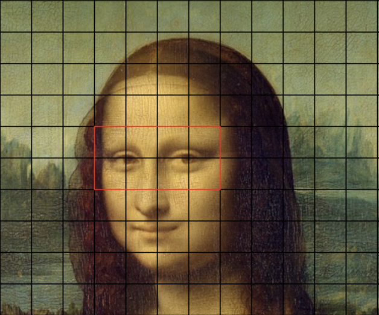
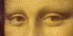
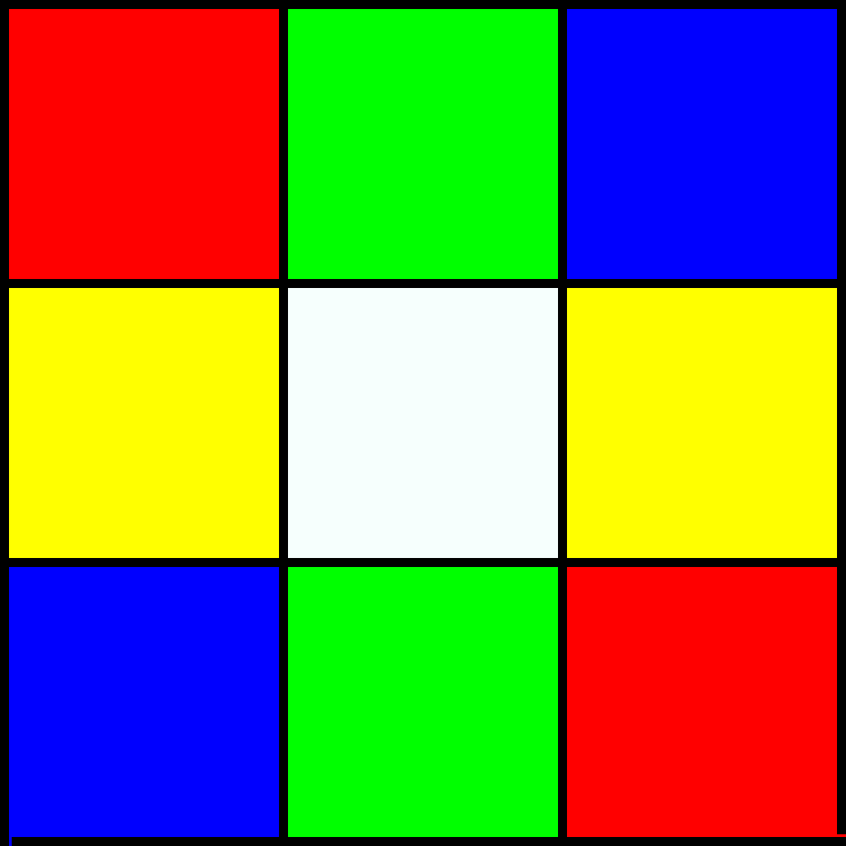
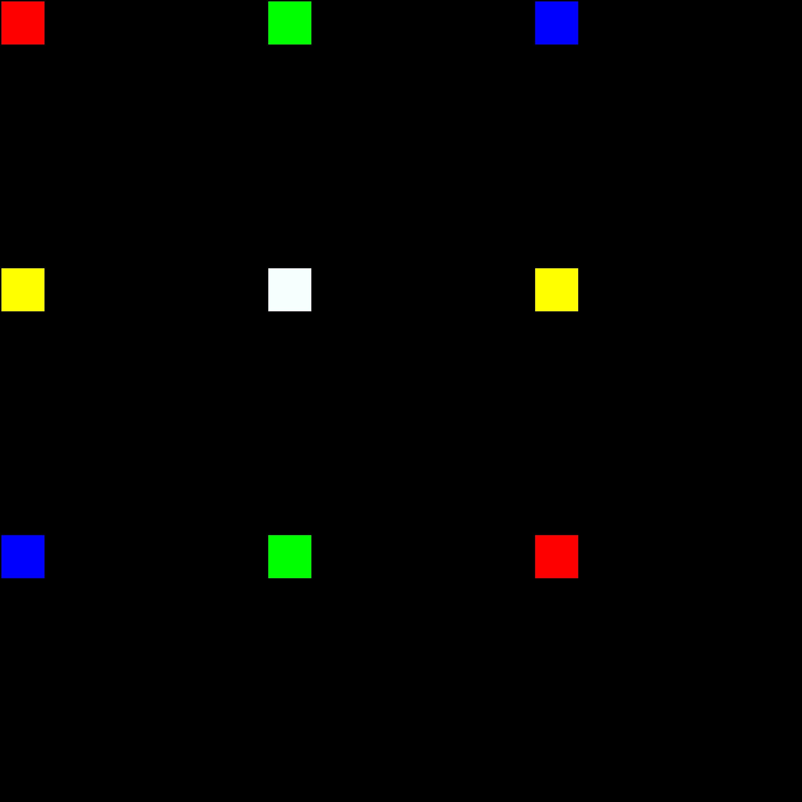
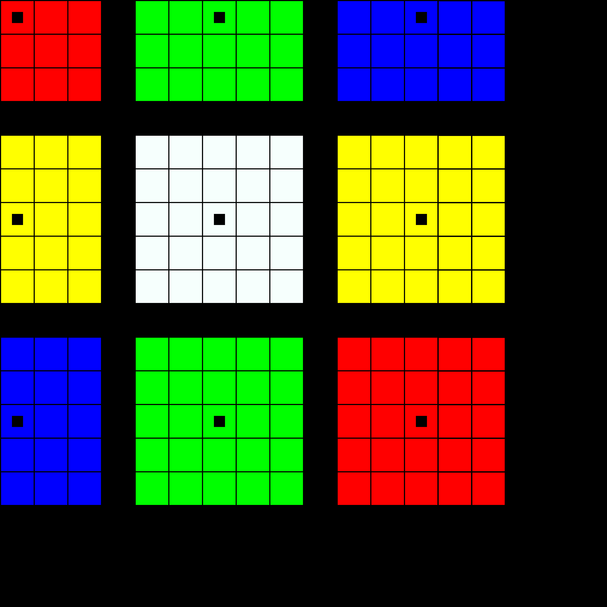
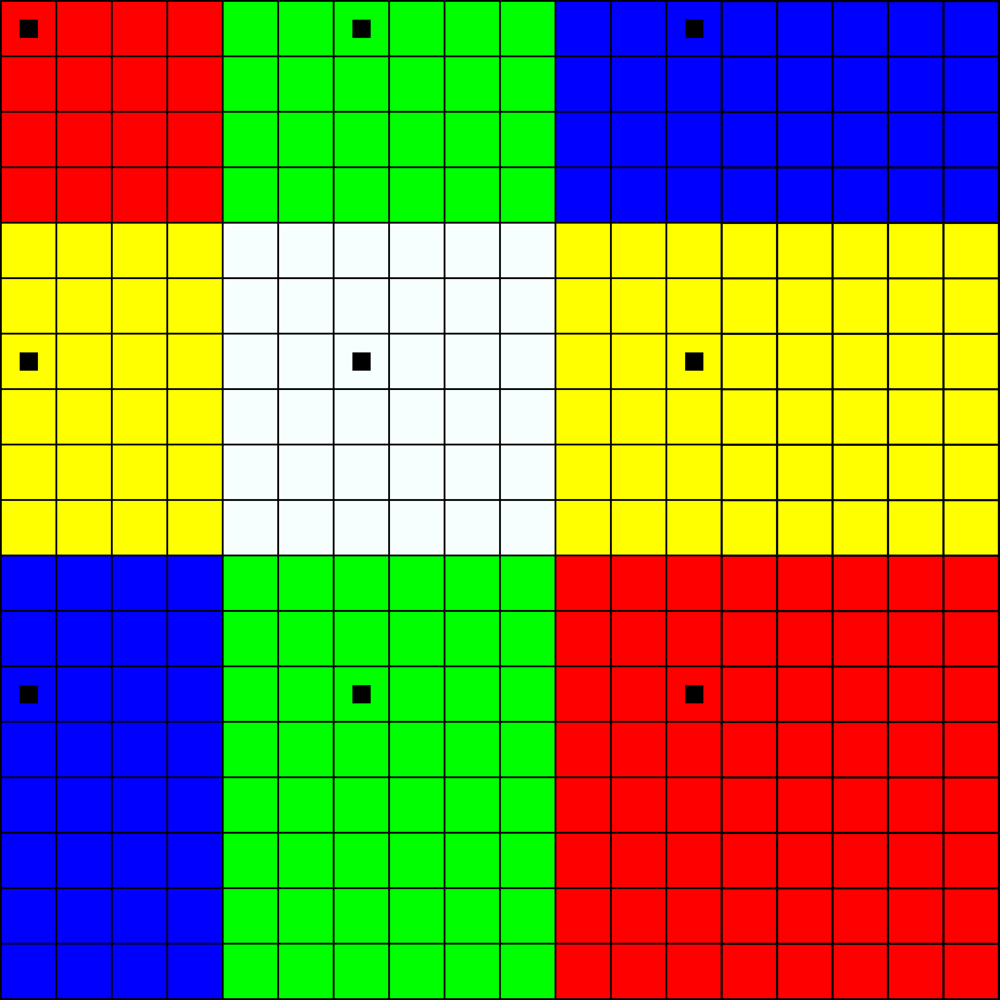

# Pixelwiederholung

A C command line program that manipulates BMP24 images. You pass it an image, pick a rectangular region (pixel coordinate plus dimensions) and it cuts that region out, enlarges it by a given scale factor and writes the result to a new file. The enlargement uses the pixel repetition method (Nearest Neighbor).

For more details, see the [full report (PDF)](Ausarbeitung/Ausarbeitung.pdf).

<p align="center">
  
  &nbsp;&nbsp;
  
</p>

## Approach

<table>
<tr>
<td width="220"></td>
<td>A 3x3 pixel image that has been cut out.</td>
</tr>
<tr>
<td></td>
<td>The source image section is enlarged by a scale factor of 6 and the individual pixels are placed accordingly in memory. The black area is the empty allocated memory.</td>
</tr>
<tr>
<td></td>
<td>The direct neighbors of each pixel are painted with the same color. The black squares mark the original source pixels.</td>
</tr>
<tr>
<td></td>
<td>Vertical gaps take the color of the pixel to their left, horizontal gaps take the color of the pixel above. This continues until all gaps are closed.</td>
</tr>
</table>

## Usage

```bash
cd Implementierung && make
./main -s 100,50 -w 800 -h 600 -f 2 -o out.bmp lena.bmp
```

`-s x,y` window start point, `-w` width, `-h` height, `-f` scale factor, `-o` output file,
`-B <n>` measures the runtime, `--help` for all options.

This was a student group project by Laert Llaveshi, Till-Ole Lohse and Yannick Sihler for the
Grundlagenpraktikum: Rechnerarchitektur (GRA) in the summer semester 2023 at the Chair for
Computer Architecture and Parallel Systems.
